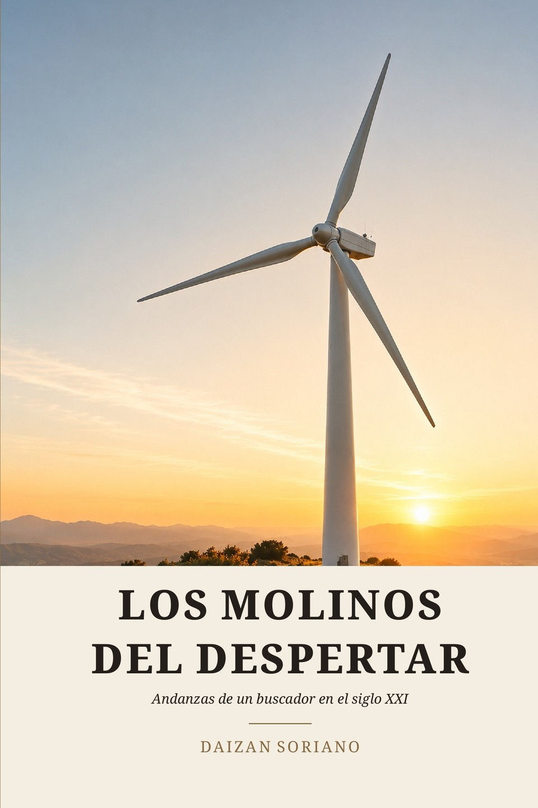

{: style="display:block;max-width:360px;width:100%;height:auto;margin:0 auto 2rem;" }

Hoy quiero compartir la publicación de **_Los molinos del despertar. Andanzas de un buscador en el siglo XXI_**, una novela que se acerca con humor a un territorio lleno de promesas: el mercado de la felicidad y del despertar espiritual.

**[Puedes encontrar el libro en Amazon](https://link.amazon/B011yOYl4).**

## Un Quijote de nuestro tiempo

Alonso Quesada se ha leído cuatrocientos seis libros sobre cómo vivir. Sigue sin saber para qué.

A sus cincuenta y cuatro años, vende un olivo heredado y un Seat Ibiza del 98 para financiar la aventura que le queda: despertar. Se rebautiza Swami Ananda Quijote y sale a recorrer la España espiritual del siglo XXI, con su esterilla a la espalda y una considerable capacidad para confundir promesas con certezas.

Le acompaña su vecino Sancho Pacha, que entiende poco del tercer ojo, pero lleva la libreta de los gastos. Entre los dos se abre el espacio de esta novela: el entusiasmo de quien quiere encontrar una respuesta definitiva y el sentido común de quien pregunta cuánto cuesta y qué hay para comer.

En el camino aparecen el coaching cuántico, los retiros de silencio, las constelaciones familiares, las canalizaciones por suscripción y el gurú que promete no morir nunca. Una geografía reconocible, habitada aquí por personajes y situaciones de ficción.

## Reírnos también de nuestra búsqueda

La sátira tiene una ventaja: permite acercarnos a nuestras contradicciones sin tener que resolverlas enseguida. Podemos sonreír ante la credulidad de Alonso y, unas páginas después, reconocer algo nuestro en su necesidad de encontrar a alguien que le explique cómo vivir.

¿Qué ocurre cuando la búsqueda de sentido se convierte en una sucesión de compras? ¿Cuántas experiencias extraordinarias necesitamos antes de prestar atención a la vida que tenemos delante? ¿Y quién nos devuelve al suelo cuando empezamos a confundir los molinos con gigantes?

Alonso y Sancho recorren esas preguntas entre talleres, caminos y cuentas pendientes. Me gustaría que su compañía te hiciera reír y te dejara alguna pregunta dando vueltas al cerrar el libro.

**[Los molinos del despertar · Ver en Amazon](https://link.amazon/B011yOYl4)**
